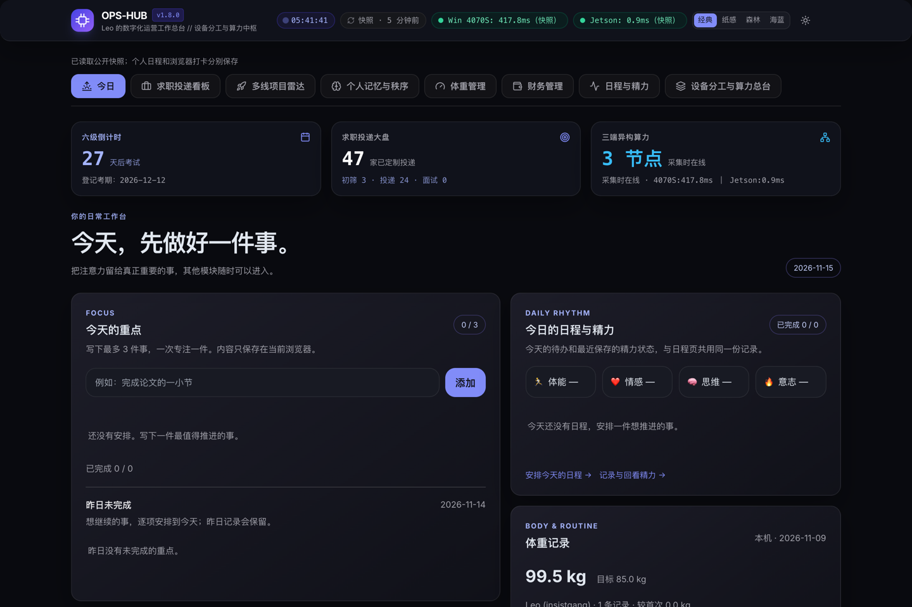
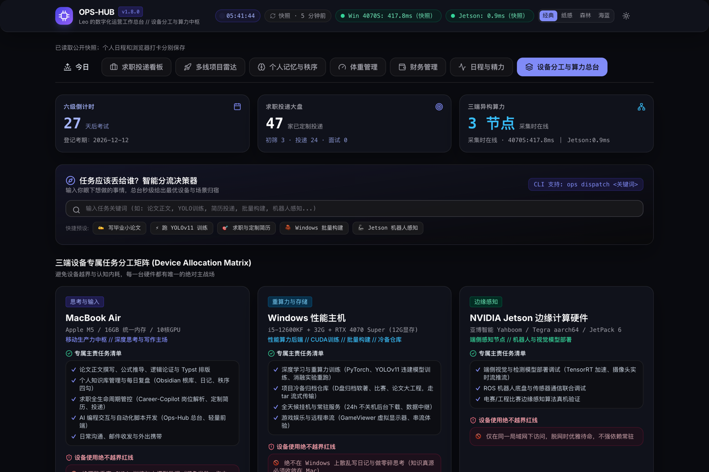
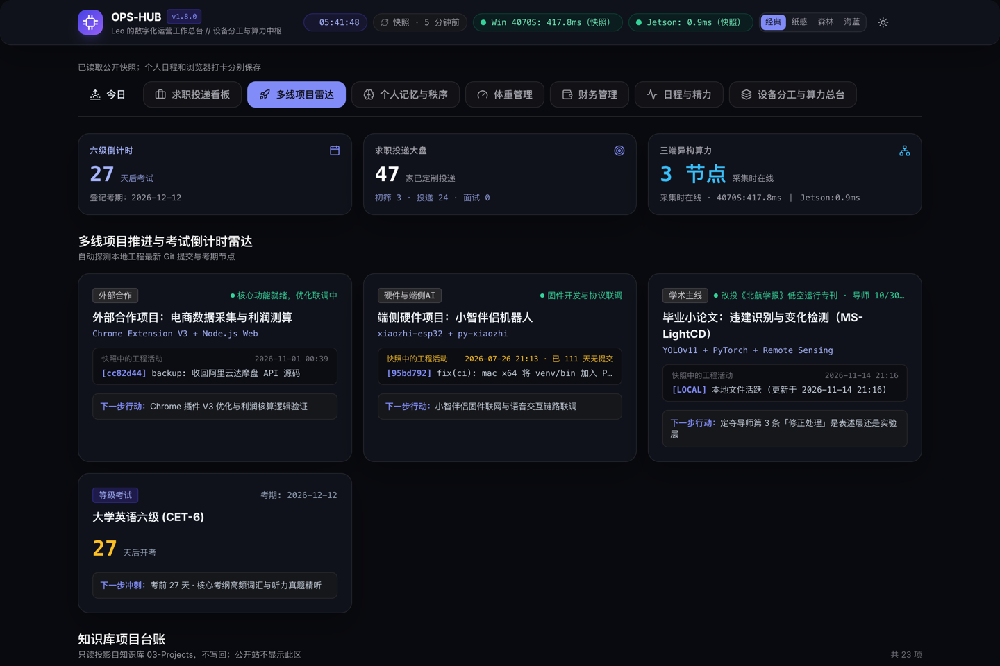

<!-- README_SYNC: source=working-tree; updated=2026-11-15 -->

<p align="center">
  简体中文 · <a href="./README_EN.md">English</a>
</p>

# 🚀 Ops-Hub · 个人数字化运营工作总台

> 把三端算力、求职投递、项目进度、日程精力和生活秩序收进**一个零构建的单页总台**：打开网页看全局，敲一行 `ops` 管日常。

如果它对你有用，欢迎点亮 [Star](https://github.com/insistgang/ops-hub/stargazers)，方便收藏，也帮助有同样需求的人发现它。

[](https://github.com/insistgang/ops-hub/stargazers)
[](./LICENSE)
[](https://github.com/insistgang/ops-hub/commits/main)
[](https://github.com/insistgang/ops-hub/issues)


**在线演示**：https://insistgang.top/ops-hub/ （阿里云）· https://insistgang.github.io/ops-hub/ （GitHub Pages 镜像）



*真实公开站截图（2026-11-15）：今日工作台 -- 六级倒计时、求职大盘、三端算力卡片与今日重点。*

## 这是什么

Ops-Hub 是一个真实在用的个人运营系统，不是 Demo。它把散落各处的日常信息汇成一页：

- **🖥️ 三端算力拓扑**：MacBook Air（移动生产力）、Windows 4070S（常驻 CUDA 算力）、Jetson（端侧感知）的网络延迟与服务状态，由真实探针采集，离线自动降级。
- **🎯 求职投递管道**：公司、岗位、投递日期、状态与跟进备注，面试/笔试自动置顶。
- **🚀 多线项目雷达**：自动读取本地各项目的 Git 最新提交与 Next Action，附考试倒计时。
- **📅 日程与精力（VitaFlow）**：日历待办、四账户精力、番茄钟、复盘，原生挂载在同一页面，支持私有云同步。
- **⚖️ 体重与 💰 财务**：体重趋势与多使用者记录；财务总览、资产、收支、复盘，账本只读、仅存页面内存。
- **🧠 今日与秩序**：每天最多 3 件重点、昨日未完成带入、每日四勾打卡，按北京时间分日。



*三端算力总台：任务智能分流决策器，以及 Mac / Windows / Jetson 的专属分工矩阵。*



*多线项目雷达：自动读取各项目最新 Git 提交、下一步行动与考试倒计时。*

## 为什么值得一看

| 差异 | 说明 |
| --- | --- |
| 🚫 零 Mock 铁律 | 所有展示数据都有真实来源；探针失败、快照缺失就如实提示，不编造数字。 |
| ⚡ 零构建单页 | 根目录 `index.html` + Tailwind CDN + Lucide，克隆即用、双击即看，GitHub Pages 秒级上线。 |
| 🛠️ CLI + 自动化 | `ops` 用纯 Python 3 标准库实现，配合 macOS `launchd` 早晚自动采集、脱敏、提交、发布。 |
| 🔐 隐私分级公开 | 私有真源不进 Git；公开站只展示本人明确选择公开的脱敏投影，解析失败宁可留白。 |

## 快速开始

```bash
git clone https://github.com/insistgang/ops-hub.git
cd ops-hub

# Option 1: open index.html directly in a browser (zero build, zero dependencies)
# Option 2: serve a local preview (listens on 127.0.0.1 only)
./ops serve --port 3000
```

页面本体不需要任何安装。只有使用命令行套件或修改原生工作区源码时，才需要 Python 3 / Node.js。

## CLI 命令行套件（`ops`）

```bash
ops status                      # Terminal summary: compute, career, projects, daily checks
ops dispatch "run YOLOv11"      # Task routing: which machine should take this job
ops sync --push                 # Full collection + sanitized snapshots + GitOps commit & push
ops career list                 # Career ledger (also: add / update)
ops check 动了                   # Daily check-in: 起了/动了/写了/关了
ops weight 99.5                 # Log weight; omit the value to view history
ops memory                      # Personal memory & order baseline
ops quota                       # AI quota snapshot and early-stop advice
ops publish                     # Publish public artifacts to Aliyun (GitOps pushes GitHub only)
ops finance                     # Sync diary expenses into the finance ledger and publish
ops schedule install            # Install launchd auto-sync (09:00 / 21:00)
```

完整参数用 `ops <命令> --help` 查看。

## 目录与文档

```text
index.html          # 单页总台（Tab 切换，暗色默认 + 四套风格）
js/  css/           # 前端逻辑与样式（所有 innerHTML 注入过 esc() 转义）
ops                 # Python 3 标准库 CLI 入口
scripts/            # 探针、采集、脱敏、发布、launchd 描述文件
data/               # 本地真源 + public/ 脱敏产物（私有真源已 git-ignore）
vitaflow/           # 日程与精力工作区源码与同步服务
weight-tracker/     # 体重模块源码
finance/            # 财务原生界面与只读适配
tests/              # Python + Node 回归测试
docs/               # PRD、财务访问说明、云同步说明等
```

- 协作契约与模块边界：[AGENTS.md](./AGENTS.md)
- 需求与审阅：[docs/PRD.md](./docs/PRD.md)、[docs/PRD_REVIEW.md](./docs/PRD_REVIEW.md)
- 财务访问边界：[docs/finance-access.md](./docs/finance-access.md)
- VitaFlow 云同步：[docs/aliyun-vita-sync.md](./docs/aliyun-vita-sync.md)
- 当前进度与验证记录：[ROADMAP.md](./ROADMAP.md)

## 数据与隐私边界

- **公开即本人授权**：公开站展示的求职、项目、体重、日记精力等待办与摘要，均为本人明确选择公开的脱敏投影；同事与外部人物一律代号化，本机小组与他人数据不进入公开产物。
- **私有真源不出本机**：`data/private/`、私人日程与口令已 git-ignore；公开构建不嵌入私人快照。
- **知识库单向只读**：`~/Documents/knowledge` 是唯一写入口，本仓库只读投影，可用 `OPS_KNOWLEDGE_DIR` 覆盖路径。
- **财务不保存凭据**：账本只存页面内存，接口要求认证时如实提示，不索取密码；本地 file/localhost 无法跨源读取，请走线上总台。

## 本地开发与验证

```bash
node build.mjs           # Rebuild native artifacts after editing VitaFlow/weight/finance sources
node build.mjs --check   # Verify artifacts match sources; required before committing

python3 -m unittest discover -s tests -p 'test_*.py'
node --test tests/*.cjs weight-tracker/tests/*.cjs
```

改动任何 js/css 后需同步提升 `index.html` 里的 `?v=` 版本号，`tests/test_asset_versions.cjs` 会拦截漏改。更多验证入口见 [AGENTS.md](./AGENTS.md)。

---

如果这个项目的思路对你有启发，可以点一个 [Star](https://github.com/insistgang/ops-hub/stargazers) 方便以后回来；问题和改进建议请直接提 [Issue](https://github.com/insistgang/ops-hub/issues)，也欢迎 [Watch](https://github.com/insistgang/ops-hub/watchers) 关注后续更新。

## 📄 License

[MIT](./LICENSE) © 2026 [Leo (insistgang)](https://github.com/insistgang)
