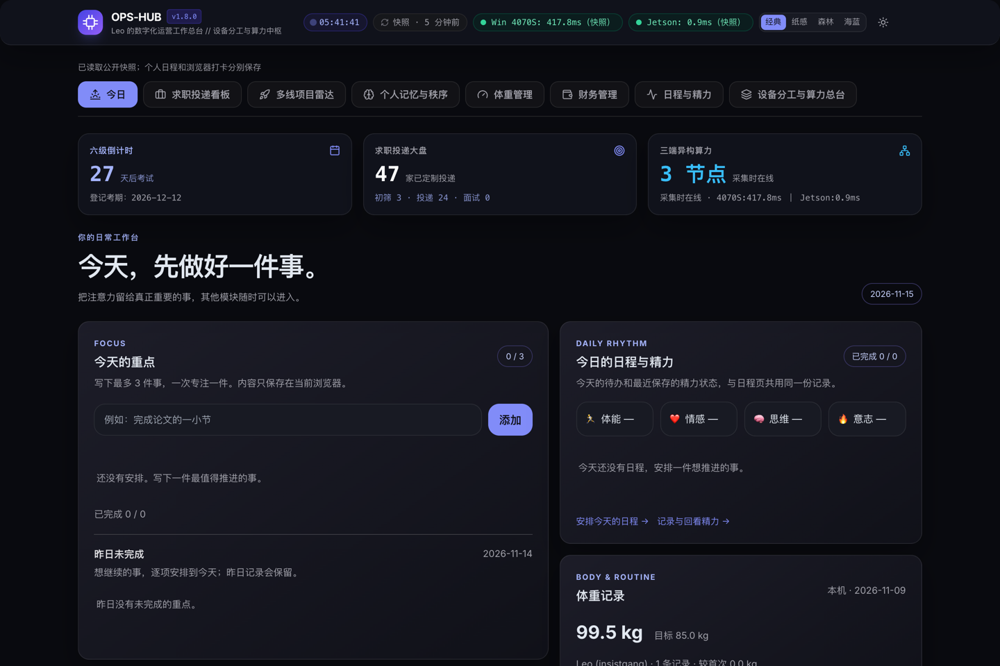
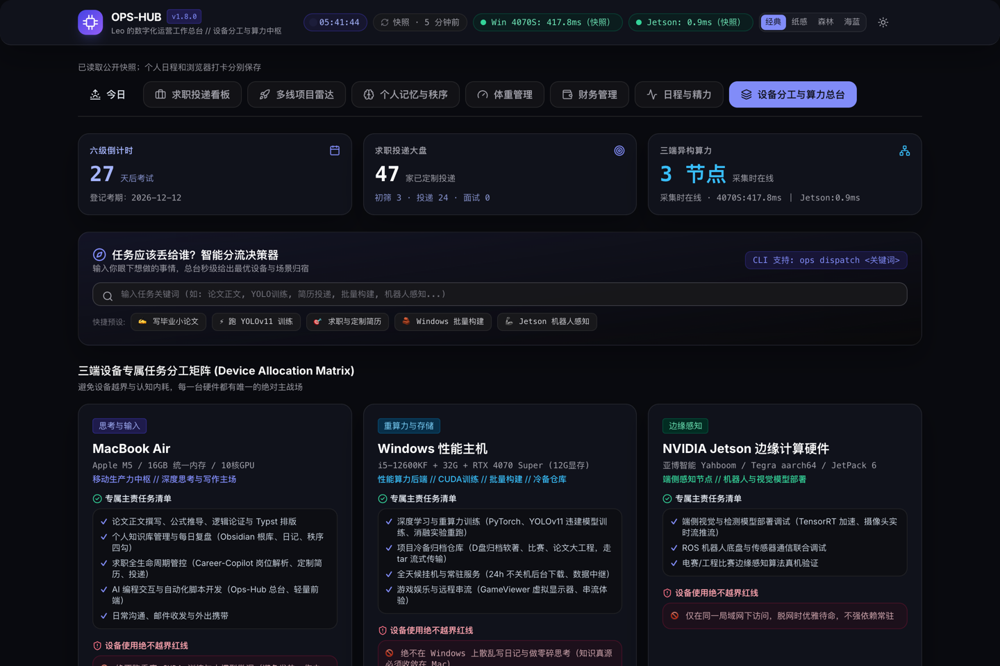
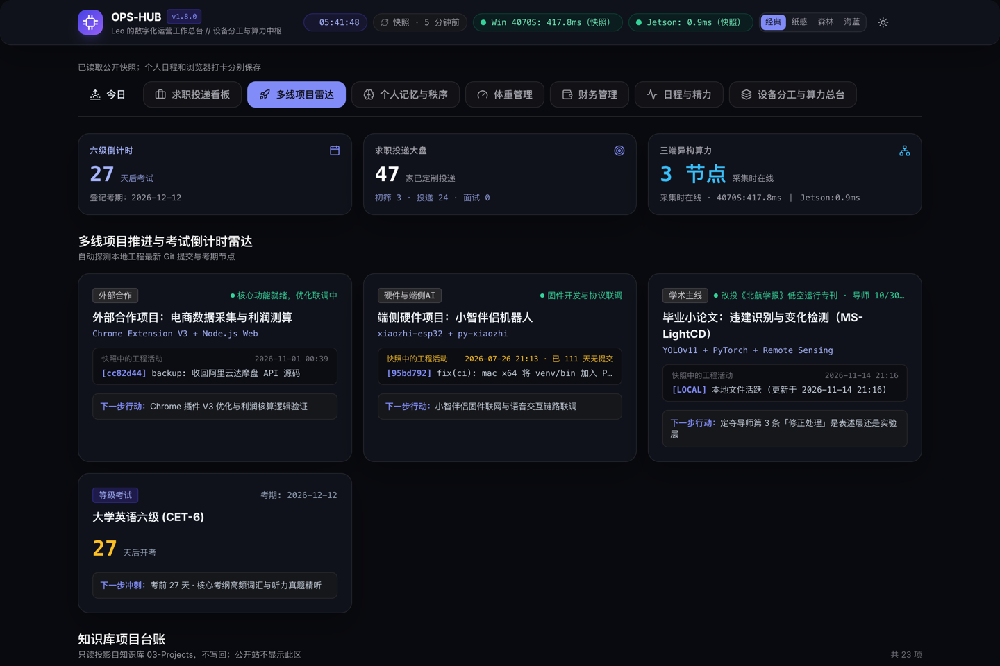

<!-- README_SYNC: source=working-tree; updated=2026-11-15 -->

<p align="center">
  <a href="./README.md">简体中文</a> · English
</p>

# 🚀 Ops-Hub · Personal Operations Console

> One zero-build single page for everything that runs a digital life: three-machine compute, job applications, project momentum, schedule & energy, and daily order. Open the page to see the whole picture; type `ops` to run the day.

If this project is useful to you, consider giving it a [Star](https://github.com/insistgang/ops-hub/stargazers) — it helps you find it again and helps others discover it.

[](https://github.com/insistgang/ops-hub/stargazers)
[](./LICENSE)
[](https://github.com/insistgang/ops-hub/commits/main)
[](https://github.com/insistgang/ops-hub/issues)


**Live demo**: https://insistgang.top/ops-hub/ (Aliyun) · https://insistgang.github.io/ops-hub/ (GitHub Pages mirror)



*Real screenshot of the public site (2026-11-15): the Today workspace — exam countdown, career overview, three-machine compute cards, and daily priorities.*

## What it is

Ops-Hub is a personal operations system in real daily use, not a demo. It pulls scattered day-to-day signals into one page:

- **🖥️ Three-machine compute topology**: live latency and service status for a MacBook Air (mobile productivity), a Windows 4070S box (always-on CUDA compute), and a Jetson edge device (on-device perception), collected by real probes with graceful offline degradation.
- **🎯 Job application pipeline**: company, role, dates, stage badges, and follow-up notes, with interviews and written tests automatically pinned to the top.
- **🚀 Multi-project radar**: reads each local project's latest Git commit and next action, plus exam countdowns.
- **📅 Schedule & energy (VitaFlow)**: calendar todos, four-account energy tracking, Pomodoro, and reviews, mounted natively in the same page with optional private cloud sync.
- **⚖️ Weight & 💰 Finance**: weight trends with multi-user records; finance overview, assets, income/expenses, and reviews — the ledger is read-only and kept in page memory only.
- **🧠 Today & order**: at most 3 daily priorities, carry-over of yesterday's unfinished items, and four daily check-ins, all day-bound by Beijing time.



*The compute console: a task-routing decision helper and the dedicated Mac / Windows / Jetson allocation matrix.*



*The project radar: latest local Git commits, next actions, and exam countdowns, collected automatically.*

## Why it stands out

| Difference | What it means |
| --- | --- |
| 🚫 Zero-mock axiom | Every number on the page has a real source. Probe failures and missing snapshots are reported honestly — never filled with invented data. |
| ⚡ Zero-build single page | A root `index.html` with Tailwind CDN and Lucide. Clone and open — no bundler, and GitHub Pages deploys in seconds. |
| 🛠️ CLI + automation | The `ops` CLI is pure Python 3 standard library, paired with macOS `launchd` jobs that collect, sanitize, commit, and publish twice a day. |
| 🔐 Privacy-tiered publishing | Private sources never enter Git. The public site only shows sanitized projections the owner explicitly chose to publish; parse failures leave honest blanks. |

## Quick start

```bash
git clone https://github.com/insistgang/ops-hub.git
cd ops-hub

# Option 1: open index.html directly in a browser (zero build, zero dependencies)
# Option 2: serve a local preview (listens on 127.0.0.1 only)
./ops serve --port 3000
```

The page itself requires no installation. You only need Python 3 / Node.js for the CLI or when rebuilding the native workspaces.

## CLI overview (`ops`)

```bash
ops status                      # Terminal summary: compute, career, projects, daily checks
ops dispatch "run YOLOv11"      # Task routing: which machine should take this job
ops sync --push                 # Full collection + sanitized snapshots + GitOps commit & push
ops career list                 # Career ledger (also: add / update)
ops check 动了                   # Daily check-in: 起了/动了/写了/关了
ops weight 99.5                 # Log weight; omit the value to view history
ops memory                      # Personal memory & order baseline
ops quota                       # AI quota snapshot and early-stop advice
ops publish                     # Publish public artifacts to Aliyun (GitOps pushes GitHub only)
ops finance                     # Sync diary expenses into the finance ledger and publish
ops schedule install            # Install launchd auto-sync (09:00 / 21:00)
```

Run `ops <command> --help` for full options. Check-in items are Chinese literals by design.

## Layout & docs

```text
index.html          # Single-page console (tabbed, dark default + four visual styles)
js/  css/           # Frontend logic & styles (all innerHTML injection passes esc())
ops                 # Python 3 stdlib CLI entry point
scripts/            # Probes, collector, sanitizer, publisher, launchd plist
data/               # Local sources of truth + public/ sanitized artifacts (private data git-ignored)
vitaflow/           # Schedule & energy workspace source and sync service
weight-tracker/     # Weight module source
finance/            # Finance native UI and read-only adapter
tests/              # Python + Node regression suites
docs/               # PRD, finance access notes, cloud sync notes, and more
```

- Collaboration contract & module boundaries: [AGENTS.md](./AGENTS.md)
- Requirements & reviews: [docs/PRD.md](./docs/PRD.md), [docs/PRD_REVIEW.md](./docs/PRD_REVIEW.md)
- Finance access boundaries: [docs/finance-access.md](./docs/finance-access.md)
- VitaFlow cloud sync: [docs/aliyun-vita-sync.md](./docs/aliyun-vita-sync.md)
- Current progress & verification log: [ROADMAP.md](./ROADMAP.md)

## Data & privacy boundaries

- **Public means owner-approved**: everything on the public site — career, projects, weight, diary-energy todos and summaries — is a sanitized projection the owner explicitly chose to publish. Colleagues and external people are anonymized; local groups and other people's data never ship.
- **Private sources stay local**: `data/private/`, personal schedules, and passphrases are git-ignored; public builds embed no private snapshots.
- **Knowledge base is read-only**: `~/Documents/knowledge` is the only write entry point; this repo only projects it read-only. Override the path with `OPS_KNOWLEDGE_DIR`.
- **No finance credentials stored**: the ledger lives in page memory only; when the API requires authentication the UI says so instead of asking for passwords. Local file/localhost origins cannot read the ledger cross-origin — use the hosted console.

## Development & verification

```bash
node build.mjs           # Rebuild native artifacts after editing VitaFlow/weight/finance sources
node build.mjs --check   # Verify artifacts match sources; required before committing

python3 -m unittest discover -s tests -p 'test_*.py'
node --test tests/*.cjs weight-tracker/tests/*.cjs
```

After changing any js/css, bump its `?v=` query in `index.html` — `tests/test_asset_versions.cjs` fails otherwise. More verification entry points live in [AGENTS.md](./AGENTS.md).

---

If this project's approach resonates with you, a [Star](https://github.com/insistgang/ops-hub/stargazers) makes it easy to come back. Questions and suggestions are welcome in [Issues](https://github.com/insistgang/ops-hub/issues), and you can [Watch](https://github.com/insistgang/ops-hub/watchers) the repo to follow along.

## 📄 License

[MIT](./LICENSE) © 2026 [Leo (insistgang)](https://github.com/insistgang)
